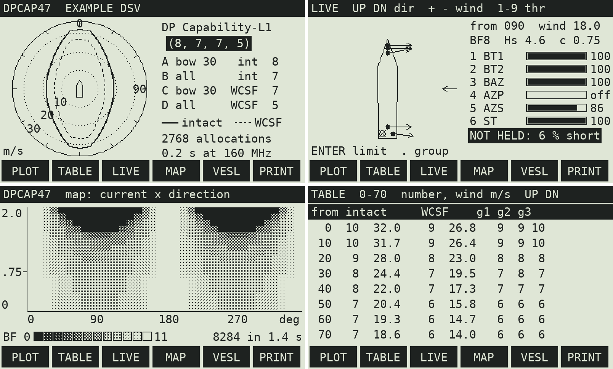
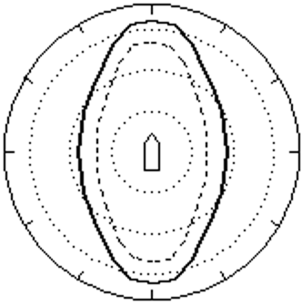
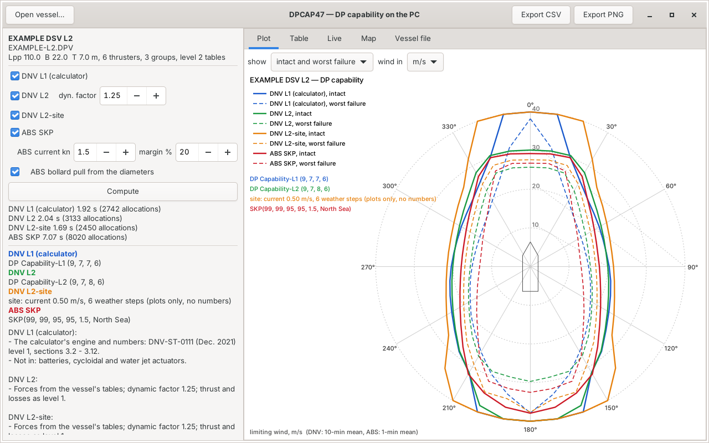
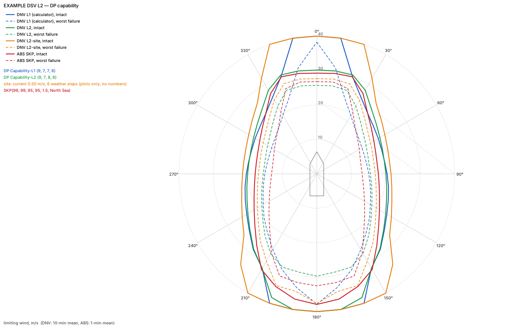

# DPCAP47 — DP capability on the SwissMicros DM42n

**DPCAP47.pg5** is a stand-alone DMCP5 program written in C for the SwissMicros **DM42n**. It computes a dynamic
positioning vessel's **station-keeping capability** on the calculator itself, following the frame of
**DNV-ST-0111 level 1**:

- the capability plot (the limiting wind all round, intact and after the worst single failure)
- the **DP Capability-L1 (A, B, C, D)** numbers
- a live view where you turn the weather, raise the wind and switch thrusters off, and watch each thruster's use and
  whether she holds
- a map of the limiting wind for every direction and every current from 0 to 2 m/s
- printing the plot to an HP 82240 printer over the infrared port

Part of the "47" family of projects (almanac47, chess47.pg5, nav47.pg5, hp47.pg5, zx47.pg5 …).



> **Version 0.4: it opens on the vessel page and computes only when asked (ENTER); EXIT stops a computation.** Everything here runs on the PC (`make test`,
> `make lpcheck`, `make shots`). The DM42n's speed, and printing over IR, are still to be seen.

> **Not for class, contracts or operations.** DPCAP47 follows DNV-ST-0111 (Edition December 2021) level 1 section
> by section (see [What follows the standard](#what-follows-the-standard)), but it is not DNV's software and is not
> approved by DNV. For a real assessment, use DNV's own tool or a DP capability analysis by a competent body.

## Install on the DM42n

1. **Back up the calculator disk first** (connect USB, copy everything).
2. Copy `release/DPCAP47.pg5` to the root of the calculator's USB disk.
   Also keep the current `DM42-x.yy.pg5` (or your C47 `.pg5`) there, so you can go back.
3. Open the DMCP menu: **SETUP → System → Run DMCP**, or press **RESET while holding F1**.
4. Choose **Load program → DPCAP47.pg5**.

At the start DPCAP47 writes `/DPCAP47/EXAMPLE.DPV`, then runs the level 1 analysis of the example vessel. The time it
took is shown under the numbers. To return to Free42 or C47: **EXIT → 4 setup → System**, or use **RESET+F1**.
DPCAP47 needs DMCP5 3.57 or later.

## The pages

| Key | Page | What it shows |
|---|---|---|
| F1 | **PLOT** | The capability plot: the limiting wind (m/s) for weather from each direction, intact (thick line) and the worst single failure (dashed). The A B C D numbers. ENTER computes it again. **F1 again shows the plot on the whole screen**, and F1 once more goes back. **+ switches the rings between m/s (10, 20, 30) and knots (10 to 60).** |
| F2 | **TABLE** | Each direction's capability number and limiting wind: intact, the worst single failure, and each group's failure. UP/DOWN scroll. |
| F3 | **LIVE** | The vessel, the weather's arrow and each thruster's force. UP/DOWN turn the weather 10°. + − change the wind by 1 m/s, × ÷ by 0.1. Keys 1–9 switch a thruster off and on, `.` fails the next redundancy group, 0 restores all. **ENTER finds the limiting wind for this direction, live.** |
| F4 | **MAP** | ENTER computes the limiting wind for 36 directions × 17 currents (0 to 2 m/s): 612 searches. Black means the vessel cannot hold even at Beaufort 0, white means it holds at 11. |
| F5 | **VESL** | The vessel file: the hull, the areas, and each thruster with the thrust left after the losses. |
| F6 | **PRINT** | The numbers, the plot and the table to an HP 82240 over IR (untested on a printer yet). |
| EXIT | menu | 1 load a vessel file, 2 write the example, 3 use the example, 4 setup (time, USB disk, System), 5 about, **6 the method (DNV / ABS)**, **7 the ABS current (0.5–3 kn)**, **8 the ABS margin (0–30 %)**, F6 OFF. |

**Two methods.** On PLOT and TABLE, the `.` key switches between **DNV-ST-0111 level 1** and **ABS SKP** (also
EXIT → 6). The calculator remembers the choice.
- **ABS PLOT** shows the intact envelope and the worst-case failure (dashed), and SKP(a, b, c, d).
- **ABS TABLE** shows each direction's limiting wind: intact, (b) the least effective thruster lost, (c) the most
  effective thruster lost, (d) the worst group lost.

The ABS winds are 1-min means and DNV's are 10-min means. The ABS calculation is the same as the PC program's (`make
pccheck` compares them).

The numbers, as in DNV-ST-0111 2.2 (Table 2-1 is the Beaufort scale's wind, Hs, Tp and current):

- **A**: the lowest number for weather within 30° of the bow, intact
- **B**: the lowest all round, intact
- **C**: the lowest within 30° of the bow, worst single failure
- **D**: the lowest all round, worst single failure

The worst single failure is the loss of each redundancy group in turn (the lowest result a direction).



## Your own vessel: the .DPV file

Plain text in `/DPCAP47` on the calculator's disk. Write it on the PC and copy it over, then **EXIT → 1** to pick it.
DPCAP47 remembers the file.

```
name=EXAMPLE DSV
lpp=110                 # Lpp, m
b=22                    # breadth at the water line
t=7                     # summer load line draught
afw=420                 # wind: frontal area A_F,wind, m2
alw=1500                # wind: side area A_L,wind, m2
xlw=5                   # its centre X_L,air, m forward of Lpp/2
alc=770                 # current: underwater side area A_L,current (default lpp*t)
xlc=0                   # its centre X_L,current
los=114                 # waves: L_OS, the length under water (default Lpp)
xlos=1                  # X_LOS, the position of Los/2 (default 0)
bowdeg=34               # bow angle, DEGREES (Figure 3-2; default 35)
awlaft=1150             # water plane area aft of Lpp/2, m2 (default: CWLaft = 1)
skeg=-38,0              # the aft-most point of a skeg or gondola (x, y); up to 2
gen=1,6000              # kW group 1 generates (optional; 10 % is kept for the ship)
# thr=NAME,TYPE,x,y,kW,kN,group,fzFrom,fzTo,OPTS,D,z,Ar,k1
thr=BT1,TUN,48,0,1500,0,1,0,0,,2.4,3.0
thr=BAZ,AZD,40,0,1500,0,3,80,100,,2.6,-1.0
thr=MP,PROP,-42,-4,2000,0,1,0,0,RC,3.4,2.4,5.5,1.1
```

The hull lines have the names of DNV-ST-0111 Table A-2. A value the file leaves out gets the default shown, and the
PC program lists everything assumed.

Each `thr=` line (DNV-ST-0111 Table A-3):
- **x, y, z**: m forward of Lpp/2, m to **starboard**, m above the base line (at the propeller, as 3.8.3 defines).
- **TYPE**: `TUN` tunnel, `AZI` open azimuth or pod, `AZD` ducted azimuth or pod, `PROP` shaft line propeller.
- **kW**: the MCR brake power available in DP (P_B). **kN**, if not 0, is the nominal thrust and replaces the formula.
- **group**: the redundancy group (1–6), from the DP FMEA.
- **fzFrom, fzTo**: a forbidden zone, the thrust directions (where the thrust pushes the vessel, 0° ahead, 90° to
  starboard, clockwise) the azimuth may not use. Zones from one azimuth washing another are added by DPCAP47.
- **OPTS**: `R` rudder behind it, `C` CPP, `D` ducted, `I` rounded tunnel inlet, `B` broken inlet, `P` pod,
  `X` contra-rotating.
- **D**: the propeller diameter (m). It is needed for the thrust formula and the ventilation loss. Without it,
  DPCAP47 uses a typical kN per kW and says so.
- **Ar, k1**: the rudder's area behind the propeller (m²) and its profile coefficient (Table 3-5: 1.1 for NACA or
  flat-sided, 1.35 hollow, 1.4 fish tail, 1.65 flap, 1.9 nozzle rudder).

`vessels/` has made-up examples:
- `EXAMPLE.DPV`: a DSV with tunnels, a bow azimuth, two aft azimuths and a skeg.
- `PSV.DPV`: a supply vessel with two CPP propellers and rudders.
- `EXAMPLE-L2.DPV`: the DSV with level 2 tables.

None of them is a real vessel.

## What follows the standard

DPCAP47 follows **DNV-ST-0111, Edition December 2021, Section 3 (DP capability level 1)**:

| Section | What DPCAP47 does |
|---|---|
| 2.2, Table 2-1 | Wind, Hs, Tp and current for each DP capability number; between the steps, linear (for the limiting wind) |
| 2.4.4, 2.4.6 | Counted up from the lowest condition; 10° directions |
| 2.4.7, 2.5 | A B C D; the worst single failure = the lowest result a direction across the redundancy groups |
| 3.2.2, 3.3 | Wind, current and waves from the same direction, × 1.25, balanced statically (forces and moment); Tp = 1.4049 Tz |
| 3.5, 3.6 | The wind and current force formulas (−0.7 cos, 0.9 sin, the moment lever moving along the hull; −0.07 cos, 0.6 sin) |
| 3.7 | The wave drift formulas (bow angle, CWLaft, the period functions f(T′) for surge and sway, Los and xLos) |
| 3.9.2 | Nominal thrust T = η1 η2 (D P)^(2/3), P = P_B ηM (Tables 3-1 to 3-4) |
| 3.9.3, 3.9.4 | β_misc = 0.9; the ventilation loss β_vent from the propeller's depth, the sea and its direction, the propeller load |
| 3.10 | Rudders: F_surge = T (1 − Cx α²), F_sway = T Cy α, α ≤ 30°, Cy = 0.0126 k1 k2 Ar/D²; nothing astern |
| 3.11.2 | Forbidden zones from the file |
| 3.11.3 | An azimuth may not wash a working thruster (not a tunnel) closer than 15 D: a forbidden sector of ±arctan(0.1 + D/s) |
| 3.11.4 | Washing a dead thruster (not a tunnel) closer than 8 D (4 D ducted): the thrust loss, interpolated across the sector |
| 3.11.5 | Washing the skeg: the loss of Tables 3-7 and 3-8 |
| 3.12.3 | 10 % of each group's generated power kept for the ship |

**Not in yet:**
- batteries (3.12.2);
- cycloidal, rim-driven and water-jet actuators;
- power taken as a limit *inside* the allocation (DPCAP47 checks it after the allocation).

**How it is computed.** For each direction and each Beaufort step, the thrusters must give the force that holds the
vessel. Each thruster's force must stay inside its own set:

- a tunnel's line
- an azimuth's disc, less its forbidden sectors and with the notches of its thrust losses
- a propeller's fan of thrust ahead with its rudder, or its thrust astern

Each set is a union of convex pieces. The allocation minimises the residual by projected gradient with Nesterov's
momentum (FISTA). If that fails, it starts again cold, and if it came near it tries each combination of the pieces. A force is **held** when the residual is under 0.5 % of the
demand and no group uses more power than it has. The limiting wind between the Beaufort steps is then found by
bisection (Hs, Tp and current interpolated in Table 2-1).

`make lpcheck` checks the allocation against an exact linear programme (scipy), for every direction, case and Beaufort
number. It reads the engine's own pieces and ventilation losses, so it checks the same model with an exact solver. On
the example DSV it agrees in all 1580 cases, and on the PSV in all 1185 (cases within 1 % of the edge are not
judged). `make test` also works the formulas of 3.5–3.11 out again, independently.

## On the PC: the GTK program

`tools/dpcap47_gtk.py` runs the **same C engine** as the calculator, built as a library, so DNV level 1 gives the
calculator's numbers. It then puts other methods next to it:

| Method | What it uses |
|---|---|
| **DNV L1 (calculator)** | The calculator's engine and numbers, unchanged. |
| **DNV L2** | Table 2-1 and the vessel's **own coefficient tables** (`cw=`, `cc=`, `cd=` in the vessel file), with the dynamic factor you choose. Gives DP Capability-L2 (A, B, C, D). |
| **DNV L2-site** | A site's own weather (`site=wind,Hs,Tp` lines and `sitecur=`). Plots only, no numbers, as in the standard. |
| **ABS SKP** | The ABS DPS Guide's North Sea wind–wave table (1-min mean wind) and a fixed current (1.5 kn by default). It adds a 20 % margin on the weather and the ABS bollard pull from the propeller diameters. The result is SKP(a, b, c, d, e, f): the % of directions the vessel holds intact, after losing the least and the most effective single thruster, and after the worst-case failure, at current e and location f. |

The thrust allocation is the same C code for every method, so only the weather, the thrust and the rules differ.



The pages:
- **Plot**: every method's envelopes on one plot, in m/s or knots.
- **Table**: every case, direction by direction.
- **Live**: turn the weather, raise the wind and switch thrusters off, with the DNV or ABS forces and thrust.
- **Map**: the limiting wind for every direction and current.
- **Vessel file**: edit the file here and press Apply.

Export PNG saves the plot and Export CSV saves every number.



```bash
# Arch: sudo pacman -S python-gobject gtk4 python-cairo   (and python-scipy for make lpcheck)
cd ~/opt/dpcap47.pg5
make lib                                   # build/libdpcap.so: the calculator's engine for the PC
make pccheck                               # the methods checked (level 2 without tables = level 1, ABS ...)
make pc F=vessels/EXAMPLE-L2.DPV           # the program; or: python3 tools/dpcap47_gtk.py FILE --methods=l1,l2,site,abs
```

`vessels/EXAMPLE-L2.DPV` is the example DSV with **made-up** level 2 tables and site weather, to show the format.
The calculator reads the same file and skips the PC-only lines.

### Where the formulas come from

- **DNV-ST-0111** (Assessment of station keeping capability of dynamic positioning vessels, December 2021): free
  from DNV's rules and standards site (search "DNV-ST-0111" at dnv.com, Rules and standards). DPCAP47 implements its
  level 1 (Section 3). The copy is for your own use, so it is not in this repo. DNV's free level 1 web tool is the
  reference to compare against.
- **ABS Guide for Dynamic Positioning Systems** (2024, free at eagle.org), Section 9 *Station Keeping Performance*:
  - Table 1, the North Sea wind–wave relationship
  - the bollard pull and current reduction formulas (Appendix 1)
  - the tunnel thruster losses
  - the SKP notation

  ABS sends the wind and current forces to API RP 2SK or OCIMF (both sold separately, not in DPCAP47). The 20 %
  quasi-static margin is quoted from the 2012 edition of the Guide; check the 2024 edition's wording.
- **IMCA M 140**, *Specification and use of DP capability plots* (Rev. 2, January 2025, a complete rewrite): the
  industry's recommended practice. It covers methods for wind, wave and current forces and full-scale plots and data
  sheets. IMCA members can download it.

### Not yet

- **DNV level 3** is a time-domain simulation: a DP controller, thruster dynamics, wind gusts and slowly varying wave
  drift, run for 3 hours a case. The vessel holds if it stays within 5 m and 3°. It is a separate program (a DP
  simulator) and the next step.
- **ABS tunnel losses**: tunnels keep the DNV level 1 values.
- **ABS rudder forces**: the Guide gives these as graphs; the ABS method uses DNV's rudder formula.
- **ABS wind and current forces**: ABS points to API RP 2SK / OCIMF. Without the vessel's own tables, the ABS method
  uses DNV level 1's formulas.
- **ABS thruster–hull interaction**.

## Build

```bash
cd ~/opt/dpcap47.pg5
make                          # build/DPCAP47.pg5 (needs arm-none-eabi-gcc)
make test                     # the engine's checks on the PC
make lpcheck                  # the allocation against an exact LP (python3 + scipy)
make table F=vessels/PSV.DPV  # a vessel file's analysis as a table, on the PC
make shots                    # the PC simulator's screens -> build/sim/run/*.png
```

## Credits and license

GPL-3.0-or-later (see `LICENSE` and `NOTICE`). The DMCP5 SDK files are SwissMicros', BSD 3-Clause.
Written with the help of AI, as a cooperation (see [AI_ASSISTANCE.md](AI_ASSISTANCE.md)).
Please don't contact SwissMicros about this program.
